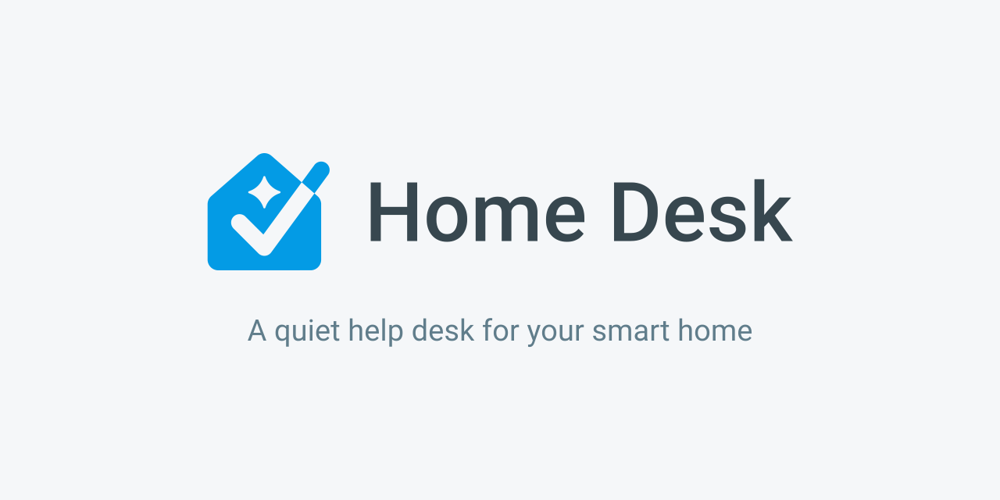
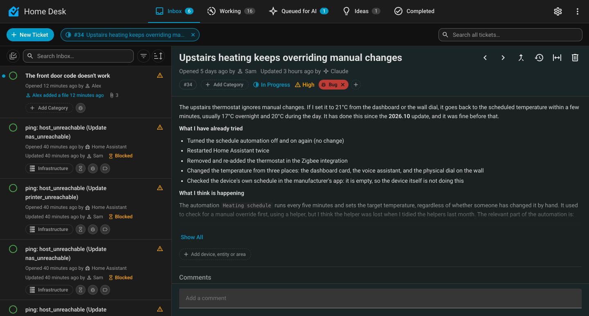

<picture>
  <source media="(prefers-color-scheme: dark)" srcset="brand/extras/social-preview-dark-1280x640.png">
  
</picture>


Something in the house stops working, a household member has a request, or you have an idea for later, and it lives in your head, a chat thread or a note on the fridge. Home Desk is a helpdesk that lives inside Home Assistant. You, your household, AI agents and Home Assistant itself raise tickets; you and your AI agents work them through to resolution, with the full history kept. Home Assistant is the heart of a smart home, so it's where tickets live, but they can be about anything around it too: the network, the servers, the media box.



*A preview with sample tickets.*

## What you get

- **An interface that looks like part of Home Assistant.** A Home page (what needs you, recent activity), five tabs (Inbox, Working, Queued for AI, Ideas, Completed), a searchable, sortable list and a full-width ticket page.
- **A lifecycle that moves by itself.** New, In Progress, Resolved and Closed, with GitHub-style labels and categories for which part of the home a ticket is about.
- **Tickets from Home Assistant Repairs.** Each repair becomes a ticket, and closes itself when the repair clears. Anything else that fires an event can raise one too.
- **A simple report form for household users**, with photos and a voice message that Home Assistant's speech-to-text writes out.
- **AI that advises first.** **Review With AI** asks the AI you chose in Settings to look at a ticket and say what it thinks, and it can't change anything. **Queue** hands a ticket to an AI agent you run yourself.
- **AI is optional and has a master switch.** Turn off **Use AI** in Settings and every AI control disappears and Home Desk refuses what an AI would do.

## Documentation

The full guide is at **<https://greminn.github.io/ha-home-desk/>**:

- [What is Home Desk?](https://greminn.github.io/ha-home-desk/guide/what-is-home-desk), [install](https://greminn.github.io/ha-home-desk/guide/install) and [your first ticket](https://greminn.github.io/ha-home-desk/guide/first-ticket)
- [Getting around](https://greminn.github.io/ha-home-desk/guide/getting-around), [status](https://greminn.github.io/ha-home-desk/guide/status) and [labels and categories](https://greminn.github.io/ha-home-desk/guide/labels-categories)
- [Household reports](https://greminn.github.io/ha-home-desk/guide/household-reports), [Home Assistant Repairs](https://greminn.github.io/ha-home-desk/guide/repairs) and [Settings](https://greminn.github.io/ha-home-desk/guide/settings)
- [Automations and notifications](https://greminn.github.io/ha-home-desk/guide/events)
- [Using AI with Home Desk](https://greminn.github.io/ha-home-desk/ai/using-ai) and [connecting your own AI agent](https://greminn.github.io/ha-home-desk/ai/access)

## Installation

Needs **Home Assistant 2024.10** or newer. Home Desk is a **pre-release** and isn't in the HACS default repository yet, so it's added as a custom repository.

[](https://my.home-assistant.io/redirect/hacs_repository/?owner=Greminn&repository=ha-home-desk&category=integration)

1. Click the button above, or in HACS choose **⋮ → Custom repositories**, paste `https://github.com/Greminn/ha-home-desk` and set **Type** to **Integration**.
2. Install **Home Desk** (turn on **Show beta versions** if you don't see it; that is HACS's name for pre-releases).
3. Restart Home Assistant, then **Settings → Devices & Services → Add Integration → Home Desk**.

Prefer to copy files by hand? Put `custom_components/home_desk/` into your `/config/custom_components/`. The [install guide](https://greminn.github.io/ha-home-desk/guide/install) has the details.

## Quick start

1. Open **Home Desk** from the sidebar and select **New Ticket**.
2. Give it a title and a description. It lands in the **Inbox** as **New**.
3. Open it, set the priority, a category and labels, and comment. The first change moves it to **Working**.
4. When it's fixed, type the cause and the fix in the comment box and select **Resolve**. It moves to **Completed** and closes after the delay you set in Settings.
5. Optional: pick **Review** in the reply bar and press **Review With AI Now** for a second opinion.

The [first ticket walkthrough](https://greminn.github.io/ha-home-desk/guide/first-ticket) covers each step.

## Using it with AI assistants and automations

Home Desk's services return real data, so an assistant or an automation can read and work tickets (they need an administrator). `home_desk.get_guide` tells an agent how everything works.

```yaml
actions:
  - action: home_desk.list_tickets
    data:
      priority: urgent
    response_variable: urgent_tickets
```

Every ticket change also fires `home_desk_event`, so an [automation](https://greminn.github.io/ha-home-desk/guide/events) can notify your phone. Built-in push notifications aren't available yet.

## Support the project

Home Desk is a personal project, free and shared as is. If it's useful to you and you'd like to say thanks, you can [buy me an espresso](https://buymeacoffee.com/greminn). It's never expected, and bug reports and ideas are just as welcome.

<a href="https://buymeacoffee.com/greminn"></a>

## Status

**Pre-release.** Used daily on the author's own home, but the interface may still change between releases, and it hasn't yet been tested against the wide variety of Home Assistant setups a stable release should handle.

Found a bug, or have an idea? Please [open an issue](https://github.com/Greminn/ha-home-desk/issues). Problems and feature ideas are equally welcome, not just polished bug reports.

## Development and licence

Building, testing, the mock preview and deploying are covered in [docs/development.md](docs/development.md). The panel is built from `frontend/` (Lit and TypeScript) and the output is committed, so HACS and a manual copy need no build step.

[MIT](LICENSE)
